# 🏥 CUT Clinic Appointment Management System
## 🌐 Live Application

🚀 **[Launch CUT Clinic Appointment Management System](https://cutclinicapp.vercel.app)**

CUT Clinic is a Flutter-based appointment management application designed to help students access clinic services and manage their appointments online.

### Technologies Used
- Flutter & Dart
- Supabase Authentication
- PostgreSQL Database
- Vercel Web Hosting

### Key Features
- Student registration and login
- Clinic appointment booking
- Appointment tracking
- Student profile management
- Notifications
- Secure authentication

**Flutter Student Application | All Safe Tech Group Project**


> **Your health, our priority.** A student-facing application for requesting and tracking clinic appointments at the Central University of Technology (CUT).

## 📖 Overview

The **CUT Clinic Appointment Management System** is a group software development project designed to make student clinic appointments easier to request and manage. This repository contains the **Flutter student application**, which connects to a shared **Supabase/PostgreSQL** backend. A separate **ASP.NET Core staff application**, developed within the wider group project, allows clinic staff to review and manage appointment requests.

I independently developed the Flutter student-facing application, including its screens, navigation, appointment workflows, authentication integration and Supabase connectivity.

## ✨ Features

### Student accounts
- Student registration, login, logout and password recovery using Supabase Authentication.
- Student profile management, profile photo options, password changes and a documents screen.
- Optional biometric unlock on supported Android devices; not available in the web browser.

### Appointment booking and tracking
- Two-step request process: **select service and preferences → review and submit**.
- Optional additional details, preferred date and time of day (any time, morning or afternoon).
- Clinic staff assign the final appointment date and time; student preferences are not guaranteed bookings.
- Appointment states such as **pending review, approved, cancelled and completed**.
- Appointment details, progress tracking, cancellation and searchable/filterable history views.
- One-active-appointment restriction enforced by the backend.

### Updates and notifications
- In-app alerts for appointment requests, approvals, cancellations and rescheduling.
- Appointment updates synchronised through Supabase.
- **Working email approval notifications** demonstrated through the integrated ASP.NET Core staff workflow. Email delivery is handled outside this Flutter repository.
- **SMS is not currently active**: the planned Twilio integration requires a configured paid sender/number.

## 🖼️ Application Screenshots

The screenshots below show the student application and a demonstration account. Appointment examples are for demonstration purposes.

| Welcome | Login |
|---|---|
| 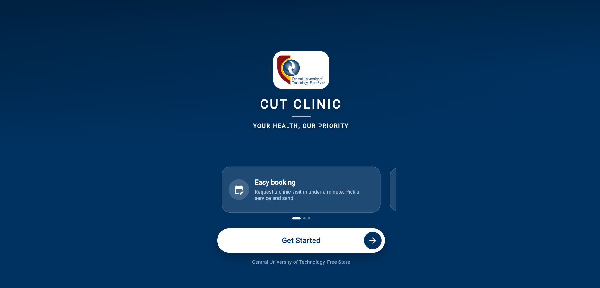 | 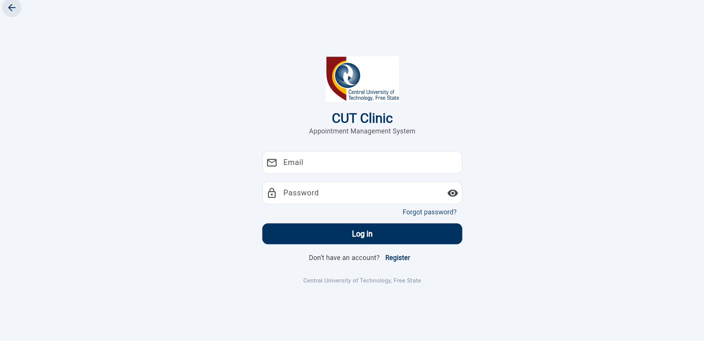 |

| Registration | Student dashboard |
|---|---|
| 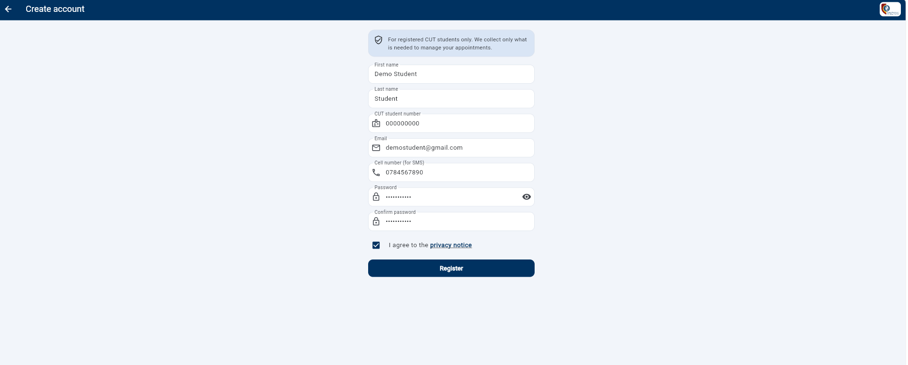 | 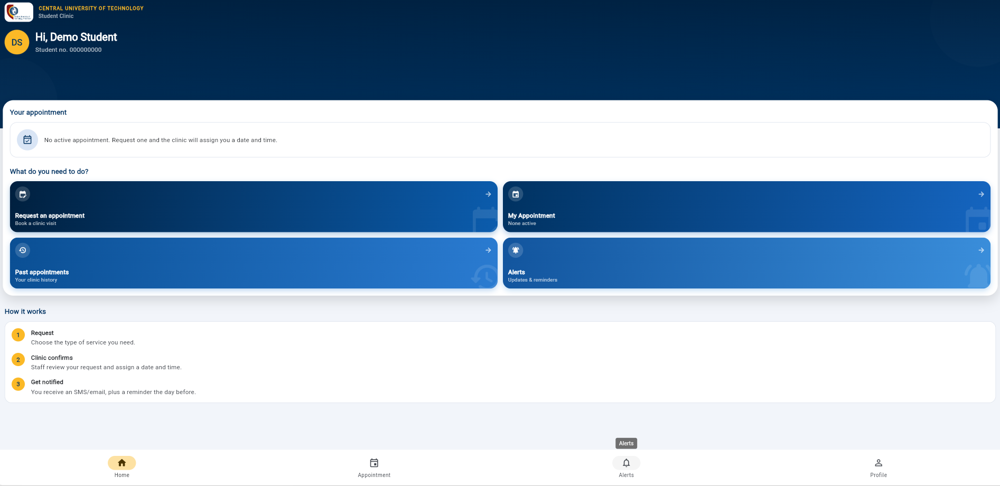 |

### Appointment request workflow

**1. Select service and preferences**

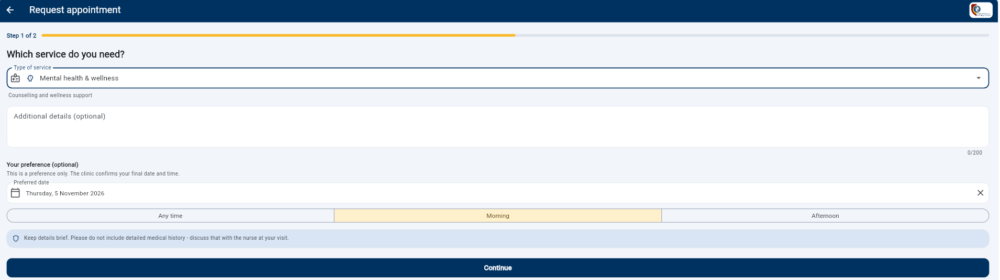

**2. Review before submission**

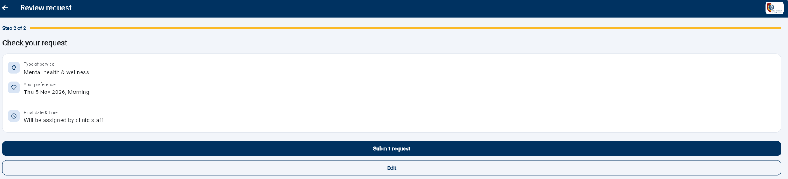

**3. Confirmation**

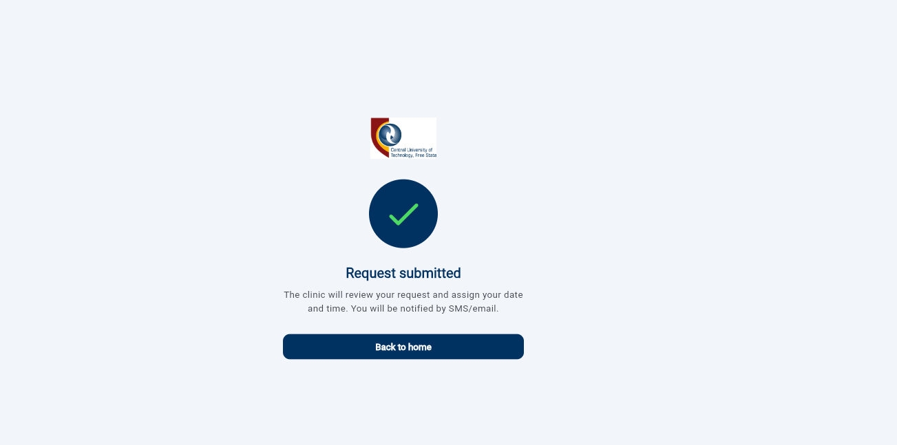

**4. Track pending appointment**

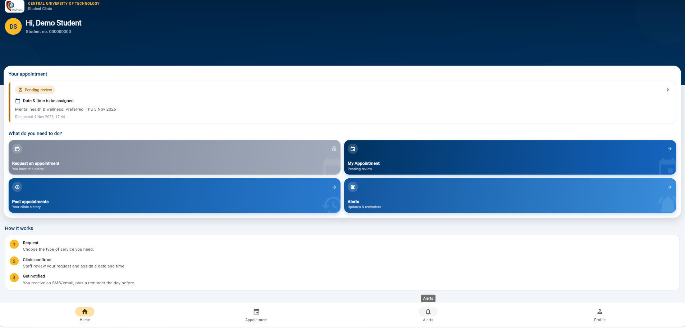

### Profile management

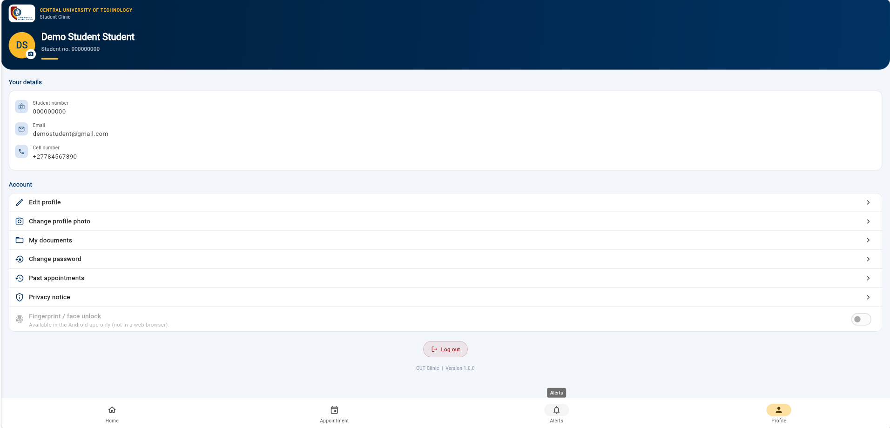

### Email approval notification

The separate ASP.NET Core staff system can send appointment approval emails, as demonstrated below. SMS is currently inactive.

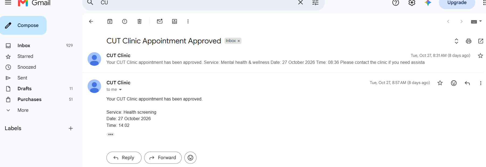

## 🎥 Demo

**Video walkthrough:** Not yet published. Add a recording link here when available.

A recommended walkthrough is: welcome → login → dashboard → appointment request → review → submission → pending review → staff approval → email notification → approved appointment → history and profile.

**Live demo:** Not currently hosted publicly. The app requires an active Supabase project and valid configuration. Free-tier Supabase projects may pause after inactivity.

## 🔄 How the System Works

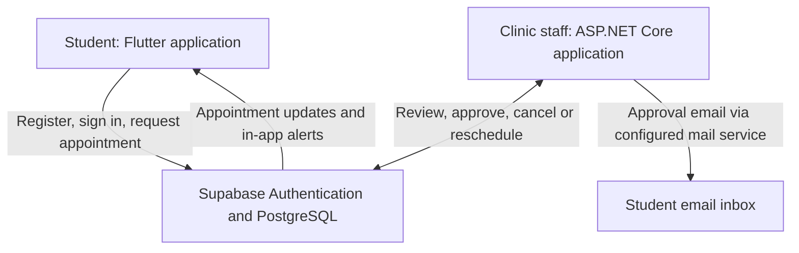

1. A student signs in and submits an appointment request.
2. The request is stored in Supabase and appears as **Pending review**.
3. Clinic staff use the separate ASP.NET Core application to review and assign an appointment slot.
4. The student app displays the updated appointment status and in-app alert.
5. The configured staff-side email workflow can send an approval confirmation to the student.

## 🛠️ Technology Stack

| Technology | Role |
|---|---|
| Flutter / Dart | Student application and UI |
| Supabase Auth | Student authentication |
| Supabase / PostgreSQL | Shared backend, appointment data and database rules |
| Supabase Realtime | Synchronising appointment updates |
| ASP.NET Core | Separate staff-facing application developed within the group |
| Git / GitHub | Source control and collaboration |
| VS Code | Development environment |

## 📁 Repository Structure

```text
cut_clinic_app/
├── assets/
│   └── images/
├── lib/
│   ├── core/              # Configuration, validation, theme and error handling
│   ├── models/            # Student, appointment, notification and document models
│   ├── screens/
│   │   ├── auth/          # Login, registration and recovery
│   │   ├── home/          # Dashboard and navigation
│   │   ├── appointment/   # Request, review, status and history
│   │   ├── notifications/ # In-app alerts
│   │   └── profile/       # Student profile and account screens
│   ├── services/          # Supabase clinic and supporting services
│   ├── widgets/           # Reusable interface components
│   ├── app.dart
│   └── main.dart
├── supabase/
│   └── schema.sql         # Tables, policies, functions and triggers
├── test/
├── web/
├── env.example.json
├── setup.ps1
├── setup.sh
├── pubspec.yaml
└── README.md
```

## 🚀 Running Locally

### Prerequisites

- Flutter SDK **3.22 or later** (and a compatible Dart SDK)
- Git and an IDE such as VS Code
- Chrome for web testing, or an Android phone/emulator for Android testing
- An active Supabase project

### 1. Clone the repository

```bash
git clone https://github.com/AllSafe-Tech/cut-clinic-student-app.git
cd cut-clinic-student-app
```

> If your repository URL or folder name differs, update these commands to match the actual GitHub repository.

### 2. Configure Supabase

1. Create or open a Supabase project.
2. Review `supabase/schema.sql` before running it. **Use a fresh development project**: applying a schema to an existing database can change its objects or policies.
3. In Supabase SQL Editor, apply the schema to the development database.
4. Copy `env.example.json` to `env.json` and fill in the project URL and **publishable/anon key** (never a `service_role` or secret key).

```json
{
  "SUPABASE_URL": "YOUR_SUPABASE_PROJECT_URL",
  "SUPABASE_ANON_KEY": "YOUR_SUPABASE_ANON_KEY"
}
```

### 3. Install dependencies

```bash
flutter pub get
```

The repository also includes `setup.ps1` (Windows PowerShell) and `setup.sh` (macOS/Linux) for initial project setup. Review these scripts before running them; they may generate local platform files and configuration.

### 4. Start the student app

For Chrome:

```bash
flutter run -d chrome --dart-define-from-file=env.json
```

For an available Android device:

```bash
flutter run --dart-define-from-file=env.json
```

To build an Android APK:

```bash
flutter build apk --dart-define-from-file=env.json
```

### 5. Run tests

```bash
flutter test
```

> **Note:** This repository is the student-facing app, not the complete staff administration system. Staff approval and external email delivery require the separately configured ASP.NET Core application and its backend services. An active Supabase project is required for authentication and appointment functionality.

## 🔐 Security and Privacy

- Student data access is restricted through Supabase Row Level Security (RLS) policies in the database schema.
- Password authentication uses Supabase Auth rather than storing plaintext passwords in application code.
- Never commit `env.json`, `.env`, passwords, service-role keys or other private credentials.
- The Supabase publishable/anon key is designed for client applications, but **RLS and correct policies remain essential**.
- Do not publish real student contact details, medical notes or identifiable screenshots in the repository.
- Do not commit generated folders such as `.dart_tool/` or `build/`.

## 👨‍💻 My Role and Contributions

**Developer:** Sinekhaya Vatsha  
**Role:** Flutter Student Application Developer  
**Group:** All Safe Tech  
**GitHub:** [@Vincent203-ctrl](https://github.com/Vincent203-ctrl)

Although the overall clinic system was a group project, **I independently developed the complete Flutter student-facing application**. My work included:

- Designing and implementing the student UI, screens and navigation.
- Building registration, authentication and student profile flows.
- Developing the appointment request, review, submission and tracking screens.
- Implementing appointment history, cancellation views and in-app alerts.
- Connecting the Flutter app to the shared Supabase backend.
- Contributing to project analysis and use-case diagrams.

The separate **ASP.NET Core staff administration application** was developed as part of the wider group project. Its staff-side approval and email notification workflow integrates with the shared backend used by my Flutter app.

## 🧭 Current Limitations and Future Improvements

- **SMS delivery:** Not active; Twilio sender/number configuration and paid service are required.
- **Email:** Approval email has been demonstrated through the separately configured staff system, not as a standalone Flutter feature.
- **Deployment:** No public hosted demo is provided yet; Supabase availability affects live testing.
- **Biometrics:** Supported only on compatible Android devices, not the web version.
- **Institutional verification:** Student number format checks do not independently verify enrolment against CUT institutional records.
- **Potential improvements:** More automated tests, accessibility checks, deployment documentation and production-ready notification monitoring.

## 🤝 Project Context

Developed as an academic group project by **All Safe Tech**, with the Flutter student application independently implemented by **Sinekhaya Vatsha**.

## 📄 License

No open-source license is declared here. Unless the project owners choose and add a license, reuse rights are not automatically granted.

---

**CUT Clinic — Your health, our priority.**
